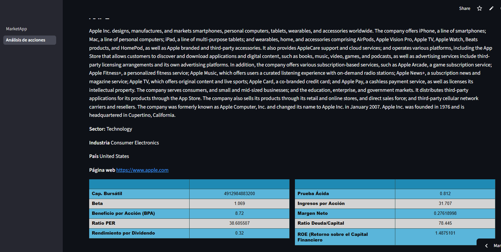
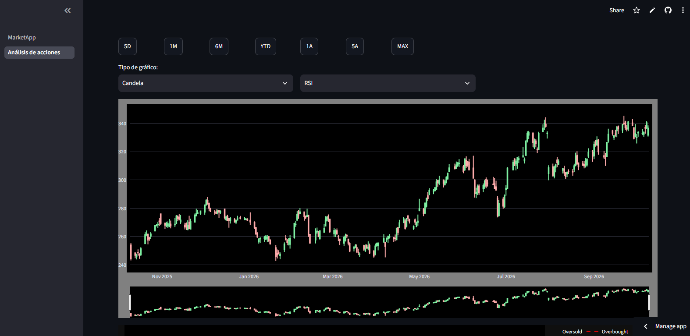

# 📈 Financial Analytics Dashboard (Prototype)

A Python-based prototype built to extract, analyze, and visualize equity market data. This project serves as a technical portfolio piece demonstrating time-series data handling, API integration, and the implementation of quantitative indicators.

> **🌎 Why is the UI in Spanish?** 
> While this documentation is in English to reach a broader technical audience, the application interface is localized in Spanish. This MVP is a foundational step toward integrating local market data from the **Bolsa de Valores de Lima (BVL)**, adapting standard quantitative analysis tools for the Latin American financial context.

## 📊 Current Features
- **Data Ingestion:** Extraction of historical pricing and fundamental corporate data using `yfinance`.
- **Technical Analysis:** Computation of basic trend and momentum indicators (RSI, MACD, and Simple Moving Averages).
- **Interactive Charting:** Dynamic candlestick and line charts built with Plotly, featuring adjustable timeframes.
- **Fundamental Snapshot:** Quick visualization of key valuation and financial health metrics (Market Cap, P/E Ratio, ROE, Quick Ratio).

## 🛠️ Tech Stack & Engineering Decisions
This prototype was built with a focus on deployment stability and clean dependency management:

- **UI Framework:** `streamlit` 
- **Data Stack:** `pandas`, `numpy`, `python-dateutil`
- **Indicators Engine:** `ta` (Consciously chosen over TA-Lib to avoid legacy C-compiler dependency issues and ensure zero-friction deployment across different operating systems).
- **Visualization:** `plotly.graph_objects`

## 🚀 Try the prototype

[👉 Press here to see the app running live](https://quantum-trading-app.streamlit.app/)

## 🗺️ Roadmap / Next Steps
This is a v1.0 prototype. Future iterations aim to include:

- Direct integration of BVL (Lima Stock Exchange) tickers.
- Integration of an LLM via API for automated summarization of technical patterns.

## ⚖️ Disclaimer
This is a personal portfolio project built strictly for educational and technical demonstration purposes. It is not a commercial application and does not provide financial advice. Market data may be delayed.
